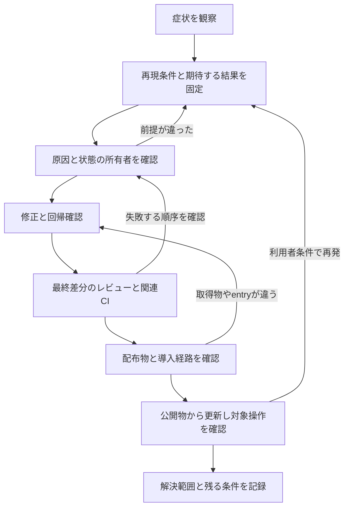

# Issueから利用者の解決まで

今回の履歴で繰り返し見えた手戻りは、ある工程で確認したことと、次の工程が必要とすることのずれでした。PRのCIが成功しても保存の完了順序は保証されず、tarballが動いてもGitHub指定では起動せず、Release jobが成功しても公開assetに不要なファイルが混ざりました。

修正を早く書くことに加え、**何が直ったと確認できたかを、次の担当へ渡すこと**が必要です。特に、実装からレビュー、配布から導入、導入から実際の操作へ進む境界を調べました。

## 読む場所

| 内容 | 文書 |
| --- | --- |
| 自作pluginで起きた追加修正を時系列で追う | [自作pluginの履歴](own-cases.md) |
| 公式・外部のIssueで原因の絞り方と解決範囲を調べる | [外部pluginと公式への提案](ecosystem-cases.md) |
| 詰まる条件、見分け方、先に置く確認 | [詰まりどころの分析](bottlenecks.md) |
| 次のIssueで調査・分担・レビュー・公開を進める | [解決までの進め方](resolution.md) |
| 件数、時刻、未確認をどう扱ったか | [調査方法と判断の限界](evidence.md) |
| IssueやPRへ短く記録する | [解決記録テンプレート](../../templates/issue-resolution.md) |

## 履歴から分かったこと

| 観察 | 工程への示唆 |
| --- | --- |
| Piの取得競合・認証期限Issueには再現条件と期待値があり、修正へつながった | この種の報告は維持する。Issueの書き方すべてを問題扱いしない |
| PiのFast PRでは能力補正の撤回と選択UIの変更があった | モデルの実体、APIの能力、利用者の選び方を別々に確かめる |
| Pi・日本語化・PWAで導入コマンドや取得物の修正が必要になった | READMEの実コマンドを、利用者と同じ取得元・profileで確認する |
| RemoraのPR CI成功後に監査ログの読み取りが失敗した | 回数や待ち時間に加え、失敗する順序を固定して確認する |
| Remoraは実DSH E2E成功後にもタブの配置修正が必要だった | 起動と操作の成功だけでは画面の位置・幅を確認できない |
| Glass UIはRelease job成功後にasset一覧を修正した | packageの中身と、Releaseに並ぶファイル全体を別々に確認する |
| Pi・Search・日本語パックの更新機能は、公開後にprofile別の操作ID復元を追加した | originだけでなく保存記録の所有先を確認し、同じURLで接続先を切り替える |
| PWAは新しい版が導入済みでも、旧版からの更新後に設定欄が出なかった | 新規導入と旧版起動中の更新を分け、Host再起動後のClient登録を確認する |
| 外部ではhostの起動設定、依存の解決位置、tool scopeが原因になった | 修正する状態の所有者と、利用者経路から見える結果を先に特定する |

各行の根拠、時刻、未確認の範囲は上の履歴文書にあります。これらは選んだ事例の分析であり、全DSH開発の原因別ランキングではありません。

## 解決を追う流れ

これはGitHubの状態機械ではありません。Issueはmerge時に自動で閉じる場合も、公開後に閉じる場合もあります。状態表示とは別に、修正コミット、含む配布版、導入後の結果を結びます。

全変更に全段階の実API試験を要求するものではありません。変更が通る境界を選び、今回の結論に関係する未確認だけを残します。文言だけの変更と、資格情報・保存・公開entryを変える変更では、必要な確認が違います。

## 先に変える3点

1. 調査時に「症状」「原因の仮説」「直ったと言える操作」を分ける。モデルなら表示名だけで識別せず、UIなら親DSHと内容欄の幅も記録する。
2. レビュー結果と検証結果を対象SHAに結び、最終差分で変わった前提を引き継ぐ。botの実行不能通知はレビュー完了に含めない。
3. 公開する取得元・版・配布物で導入し、対象操作を確認する。更新指示を出したこと、packageが入ったこと、実行版が変わったことを分ける。

これらが追加修正を減らすかは、次の数件で[発見した工程と再発条件](resolution.md#改善の効果を確かめる)を残して判断します。今回の履歴だけから改善効果の数値は出していません。
